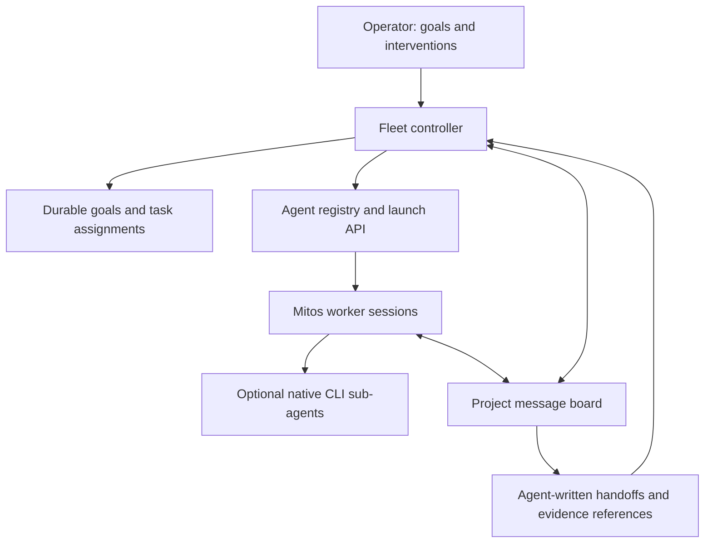

# Agent CLI abstraction and fleet orchestration

## Implemented foundation

Mitos discovers native agent executables at startup and presents an agent picker.
An optional first prompt establishes a stable session title. Without one, the
session uses an agent label and short ID until its first nonempty prompt submitted through the API.
Raw terminal input is deliberately opaque: typing directly into a CLI does not
rename the session. Session identity always remains its durable ID.

`internal/agentcli.Adapter` describes discovery, setup locations, capabilities,
and literal launch arguments. `Registry` resolves an installation and optional
profile into an executable, argument array, and private environment. The desk
manager owns PTYs, process lifecycle, output, and session persistence. Both browser
and controller clients use the same launch, prompt, input, stop, and topic APIs.
There is no command-string compatibility API.

Built-in discovery covers Codex, Claude Code, OpenCode, Pi, Gemini CLI, GitHub
Copilot CLI, Aider, Goose, Amp, Cursor Agent, Qwen Code, Cline, and Kilo, plus Bash.
This is an extensible catalog, not a claim that every installed executable is
fully integrated. Codex, Claude, OpenCode, Pi, Gemini, Copilot, and Cursor have
initial-prompt mappings. Other adapters open their interactive UI; they do not
pretend a one-shot flag provides an interactive session.

The implemented transport is PTY. Structured model events, native session resume,
and normalized usage are explicitly reported unsupported. CLI-native features
remain available inside their terminal. Native RPC adapters can later implement
those capabilities without changing controller identity or fleet ownership.

Discovery distinguishes these observations:

| Observation | Meaning |
|---|---|
| Installed | An executable exists on the selected absolute PATH or configured path |
| Version | A bounded version probe returned a version token |
| Environment present | A named variable is nonempty; its value is not returned |
| Resource present | A known config, auth, skill, memory, or session path exists |
| Authentication | Unverified; file or variable presence is not a login check |

Setup inspection stats candidate paths. It does not parse secrets, claim effective
configuration precedence, enumerate active skills, or import memory. Version
probes have individual and aggregate deadlines and bounded output; only the
version token is exposed. Custom applications opt in to probing with
`version_args`. Discovery does not launch a model task or an authentication flow.

## Native environments and applications

Sessions inherit the server's environment independently. Mitos does not run a
login shell to reinterpret agent commands. Shell aliases/functions and relative
PATH directories are not executable discovery sources. A wrapper executable can
represent more elaborate local setup.

Optional `<data>/agents.json` defines profiles and additional applications. It is
loaded on server startup; Refresh discovery rechecks installations, not this file
or the parent process environment. Restart the server after changing profiles or
exported environment variables.

```json
{
  "profiles": [
    {
      "id": "codex-work",
      "name": "Work account",
      "agent_id": "codex",
      "env": {
        "OPENAI_API_KEY": "WORK_OPENAI_API_KEY",
        "CODEX_HOME": "WORK_CODEX_DIRECTORY"
      },
      "unset": ["ANTHROPIC_API_KEY"]
    }
  ],
  "applications": [
    {
      "id": "local-assistant",
      "name": "Local assistant",
      "kind": "agent",
      "executables": ["/absolute/path/to/assistant-wrapper"],
      "args": [],
      "prompt": "positional",
      "environment_names": ["LOCAL_MODEL_URL"]
    }
  ]
}
```

`env` maps target variable names to source names in the server environment, never
literal secret values. Missing sources fail the selected launch. A profile may
also specify `executable`. `prompt` is `positional`, `none`, or a long flag such as
`--prompt`; arguments are passed directly, without shell interpolation. Source
variables remain inherited unless explicitly unset. Profiles are configuration
choices, not credential isolation between mutually untrusted local processes.

Codex, Claude, OpenCode, and Pi retain their own setup roots, skills, history, and
memory. The interface exposes candidate paths and variable presence so later
analysis can compare their models before proposing any conversion. Token/cost
statistics must eventually carry native provenance, units, and coverage; PTY
text is not a reliable billing feed. Terminal output can itself contain secrets
printed by a CLI; discovery redaction is not terminal-output redaction.

## Orchestrator architecture

The controller owns goals, assignments, fleet policy, and recovery. Agent workers
reason about tasks, report progress, propose more workers, and write handoffs.
Their CLIs may independently use native sub-agents. Those native children do not
become Mitos workers unless explicitly launched through Mitos.



The controller should normally create sessions from goals, selecting an available
adapter and profile according to task needs. Manual session creation remains an
operator tool. A coordinator role today supplies instructions and tools; **an
autonomous controller is not implemented by this change**. The existing batch
Task/run scheduler is a separate execution contract; a desk assignment's goal or
task reference does not admit a batch Task or prove its completion.

The next controller should use this cycle:

1. Persist a goal, completion conditions, task dependencies, and resource limits.
   Select a worker and persist an assignment plus a launch operation ID before
   dispatch. Reconcile that operation after a crash instead of blindly relaunching.
2. Give the worker its task prompt, relevant board topics, and instructions for
   reporting results and requesting help. Native sub-agent use remains a worker
   choice within its permissions and budget.
3. Workers publish progress, evidence, blockers, completion proposals, and requests
   to split work or recruit agents. The controller decides fleet allocation under
   the goal's policy, preserving requester and parent-task lineage.
4. Deliver operator or controller directions at any point through a recorded
   mailbox. Distinguish queued, delivered, acknowledged, and applied. A PTY write
   only proves bytes were submitted: the CLI might be showing an update menu.
   Native protocols should supply reliable turn interruption and steering where
   available; manual Ctrl+C and stop remain immediate process controls.
5. Before replacement or context exhaustion, ask the departing worker to write
   its own handoff prompt. Record objective, current conclusions, relevant files,
   changes, checks and evidence, unresolved questions, blockers, next actions,
   native-session references if available, and last consumed board cursors.
   Preserve it as a versioned board artifact. The next worker receives that prompt
   and reads referenced topics. If a worker dies first, label reconstructed context
   as a controller reconstruction, not an agent-written handoff.
6. Treat an agent's completion judgment as a proposal with evidence. The controller
   records acceptance according to the goal's completion policy, schedules further
   work when necessary, and closes sessions once their work is accounted for.

The message board is the durable communication backbone, with discoverable
summaries and bounded reads rather than every agent receiving every transcript.
Existing topics already provide revisions, stale-write rejection, post sequences,
and explicit per-participant acknowledgment cursors. A controller extension should
add typed envelopes: `assignment`, `direction`, `progress`, `blocked`,
`spawn_request`, `completion_proposal`, `handoff`, and `decision`, with goal/task,
sender/recipient, causation, idempotency key, and evidence references. Durable
inboxes and wakeups should reference these records. Prose alone must not trigger
an irreversible lifecycle transition.

Use a single durable controller lease per project, revision-checked decisions,
bounded mailboxes, dispatch concurrency and budget limits, cancellation propagation,
and explicit retries. Session status and task status are separate: an exited CLI
may leave an incomplete task; an accepted task may have a worker still running.
User intervention supersedes queued plans by revision rather than silently
rewriting past decisions. Existing interrupted-session holds remain in force.

## Controller primitives available now

`POST /api/projects/{id}/sessions` accepts `agent_id`, optional `profile_id`,
`prompt`, `role`, and `assignment`:

```json
{
  "agent_id": "codex",
  "prompt": "Investigate the terminal freeze and report evidence on the board",
  "assignment": {
    "goal_id": "goal-terminal-reliability",
    "task_id": "task-investigation",
    "requested_by": "operator",
    "handoff_topic_id": "topic_EXISTING_ID"
  }
}
```

Requesting sessions and handoff topics must belong to the same project. Goal/task
IDs are opaque references for the future controller. Assignment references are
persisted and exported as `MITOS_GOAL_ID`, `MITOS_TASK_ID`, `MITOS_REQUESTED_BY`,
and `MITOS_HANDOFF_TOPIC_ID`; a topic reference does not auto-inject its content.

Hosted agents can use the CLI without composing HTTP calls:

```sh
"$MITOS_BIN" desk agents
"$MITOS_BIN" desk inspect-agent --agent codex
"$MITOS_BIN" desk start-session --agent codex --goal goal_terminal --task task_input --prompt 'Investigate input delivery'
"$MITOS_BIN" desk send-prompt --prompt 'Write your handoff on the project board' session_ID
"$MITOS_BIN" desk stop-session session_ID
```

The existing topic commands support handoff writing and discovery. Launches are
not durably deduplicated yet. Prompt/input requests have a bounded in-memory
idempotency window; neither guarantees exactly-once execution across a restart.
These limits must be resolved before unattended controller recovery is enabled.

## Browser lifecycle and remaining integration work

Workspace styling declares a dark color scheme. A page restored from the browser
back/forward cache reloads to rebuild its disposed terminal and output connection.
This fixes a concrete stale-page lifecycle defect. It does not establish the cause
of CLI messages about orphan `app_init_liveness` or `background_liveness` streams.
Those require reproduction and inspection in the relevant native CLI; no stream
compatibility workaround is introduced.

Next protocol candidates are Codex app-server, Claude's structured interfaces,
OpenCode's server, and Pi RPC. Each needs capability-specific delivery, lifecycle,
resume, handoff, and usage tests. Configuration/memory translation and an autonomous
fleet controller follow that interface work rather than being implied by a role
label or terminal transcript.

## Native interface references

Adapter prompt conventions and setup candidates were checked against local CLI
help where available and these primary sources. They may vary by installed version;
unsupported protocols are not advertised as implemented:

- [Codex CLI reference](https://developers.openai.com/codex/cli/reference/)
- [Codex advanced configuration](https://developers.openai.com/codex/config-advanced/)
- [Claude Code CLI reference](https://code.claude.com/docs/en/cli-reference)
- [OpenCode CLI](https://opencode.ai/docs/cli/)
- [Pi coding agent](https://github.com/earendil-works/pi/tree/main/packages/coding-agent)
- [Gemini CLI reference](https://geminicli.com/docs/cli/cli-reference/)
- [GitHub Copilot CLI reference](https://docs.github.com/en/copilot/reference/cli-command-reference)
- [Cursor CLI parameters](https://cursor.com/docs/cli/reference/parameters)
- [Aider configuration options](https://aider.chat/docs/config/options.html)
