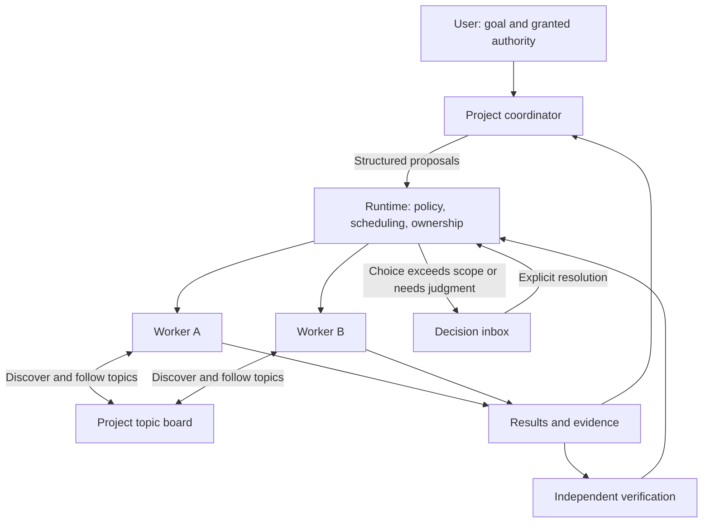

# Project workspaces and coordinated agents

Proposal · 2026-09-16 · product and architecture review, not implemented behavior.

Implementation update: [the first local workspace](INTERACTIVE_WORKSPACE.md) now
implements the session UI, topic board, shared build queue, and resource views.
The broader authority and provider contracts below remain targets.

Revised following user feedback: the primary surface is the actual hosted agent
session, presented with familiar agentic coding interactions. Coordination uses
a topic board with progressive discovery. Multiple agents in one shared directory
are a first-class workflow. See [shared workspace coordination](SHARED_WORKSPACE_COORDINATION.md)
for execution attribution, shared builds, resource accounting, and cleanup.

## Recommendation

Make Mitos a familiar environment for people who already use agentic coding CLIs.
Open the actual running session: prompts, assistant responses, tool calls,
commands, output, diffs, permission requests, and input. Structured rendering can
improve readability while preserving the session's meaning and controls. Provide
the native terminal when an adapter cannot represent an interaction faithfully.
Keep a visible project coordinator and the durable execution machinery alongside
that session, with direct access to other workers.

Use one active coordinator per project initially. It owns the plan, delegates,
answers questions settled by the brief, reconciles dependencies, and presents
unresolved choices. Workers discover and follow relevant topics on a project
message board. A deterministic runtime admits actions against permissions,
ownership, budgets, and current state. It also coordinates shared operations and
tracks their effects. Independent verification establishes completion.

This changes the current product interpretation: hiding agent sessions does not
necessarily reduce supervision. It can make intervention harder because the user
cannot see who is working, why something is waiting, or where to give direction.

## What Orca contributes

Reviewed the public repository at commit
`291b4ddd6f1c1af480169885e0fda7f9c78ff053`, its documentation, and a published pane
layout image. This was a documentation and source review, not a hands-on runtime
evaluation.

- Orca anchors work in repositories/worktrees and keeps terminals, files, diffs,
  and browser views in tabs and panes. Layout state belongs to the worktree.
  [Workspace model](https://www.onorca.dev/docs/model/worktrees) ·
  [Pane model](https://www.onorca.dev/docs/model/tabs-panes-splits).
- Its agent feed groups activity and lets the user jump back into the relevant
  workspace and session. This makes the path from an alert to its context short.
  [Agents feed](https://www.onorca.dev/docs/activity).
- Its experimental orchestration layer has a durable Run namespace, Tasks,
  Dispatch attempts, inbox messages, worker questions, and decision gates. A Run
  is not itself a scheduler. Delivery acknowledgments and dispatch-bound worker
  completion are explicit.
  [Orchestration](https://www.onorca.dev/docs/cli/orchestration).
- The inspected CLI source resolves coordinator identity for gate mutations and
  rejects group destinations for worker completion and heartbeat messages.
  [Gate handlers](https://github.com/stablyai/orca/blob/291b4ddd6f1c1af480169885e0fda7f9c78ff053/src/cli/handlers/orchestration/gate-handlers.ts) ·
  [Message handler](https://github.com/stablyai/orca/blob/291b4ddd6f1c1af480169885e0fda7f9c78ff053/src/cli/handlers/orchestration/message-send-handler.ts).

Orca also documents local line attribution from observed agent-tool edits, and
its source includes workspace cleanup and resource-manager surfaces. That does
not establish complete filesystem/process attribution or shared build reuse.
[Attribution](https://www.onorca.dev/docs/review/attribution).

The useful lesson is continuity: project, task, agent, conversation, and change
remain connected. Adopt that interaction model. Mitos can build on it with its
existing acceptance evidence, replay, and explicit decision policy. The reviewed
material does not establish a general Orca automatic-approval policy; coordinator
decision gates should not be confused with permission to perform external actions.

## Why the current UI feels unfamiliar

The current templates and product design put Overview, Work, Decisions, and
Applications first. The default page devotes space to counts and explanatory copy.
Work lists execution attempts; tasks and services are secondary links. Starting
work requires choosing an installed application. Output primarily lives in run
details and downloadable artifacts.

That is understandable for a batch execution console, but it leaves several
questions unanswered for someone working with agents: which project am I in, who
owns this task, can I talk to them, what depends on their answer, and what changed?
The existing claim and dependency machinery is more capable than this presentation
suggests. A visual reskin alone would leave that mismatch in place.

## Redefine the visible objects

| Object | Meaning and relationship to today's implementation |
|---|---|
| Project | Persistent home for repositories, goals, conversations, permissions, and team; new first-class object. A directory path alone is not project identity. |
| Goal | An outcome with constraints and acceptance criteria; groups related Tasks. Begin with one active goal per project to bound the first coordinator. |
| Task | A durable assignment, dependencies, owner, and completion condition. Reuse existing Task identity; show attempts inside it. |
| Agent session | A participant with a role, harness, current assignment, and addressable conversation. New; a local command Run is not automatically an agent session. |
| Attempt | One execution of a Task. Keep existing Run IDs and retry lineage. Do not rename Mitos Runs to match Orca's different use of “Run.” |
| Workspace | A physical checkout or copy and its source baseline. It can have several attached agent sessions. Shared-directory and separate-worktree execution are explicit modes. |
| Topic | Discoverable coordination thread with a short summary, affected paths/tasks, revision, followers, and references to details. |
| Operation | A tracked command or shared job with initiator, consumers, input identity, process lifecycle, outputs, and resource use. |
| Decision | A concrete unresolved choice or a recorded automatic choice, with scope, evidence, and resolver. |
| Automation | A reusable or recurring way to initiate work; presents installed applications and services without making their schemas the first onboarding step. |

Retain these distinctions in storage even when the UI uses a compact task row.
A retry should not look like a second unrelated assignment.

## Proposed workspace

```text
┌──────────────────┬──────────────────────────────────┬────────────────────────┐
│ Projects         │ Checkout / Improve checkout      │ Needs you · 1          │
│ ▾ Checkout       │ UI agent · shared workspace      │                        │
│   Coordinator    │ Session  Terminal  Changes        │ Topic board            │
│   API agent      │                                  │ API schema v2 · 2 new   │
│   UI agent       │ > Fix validation errors          │ Checkout behavior      │
│   Reviewer       │                                  │                        │
│                  │ Agent: Updating the form handler │ Shared operations      │
│   Tasks          │ Edit src/ui/form.rs  [diff]       │ Build #42 · API agent  │
│   Topics         │ $ cargo build                    │ 4 waiting · view output│
│   Resources      │ Joined build #42 [input revision]│                        │
│                  │ > output / warnings / exit code  │ This session           │
│ ▸ Documentation  │                                  │ Files · Git · Processes│
│ Inbox         1  │ [Prompt or supported command…]   │ CPU / memory / disk    │
│ Settings         │ [Send] [Interrupt]               │ Cleanup deferred: in use│
└──────────────────┴──────────────────────────────────┴────────────────────────┘
```

This is a proposed interaction layout, not a screenshot of working functionality.

The last session opens by default, with its project and workspace clearly named.
The left rail supplies project and session navigation; the center holds the actual
agent interaction; the right panel shows relevant topics, shared jobs, decisions,
and system activity. Selecting a worker opens its session with the task still in view.
Support a simple optional side-by-side comparison before arbitrary nested panes.

Tool calls expand to their real arguments and results; file edits link to diffs;
long commands expose live output, elapsed time, and exit status. Preserve command
history, copyable commands, keyboard input, scrollback, and supported CLI controls.
Expose the actual harness/model when reported, not invented equivalents. Distinguish
agent output, user input, and Mitos-generated coordination events visually. A
summary may be available, but cannot be the only view of activity.

Use native structured protocols where available and a PTY adapter otherwise.
Treat structured and terminal views as views of one execution, not two sessions.
Route input through one serialized channel with acknowledgments so coordinator
steering and human input cannot interleave accidentally. Adapter capabilities
determine available commands, permission responses, interrupt, and resume. Do not
send arbitrary text to a terminal based on a guessed prompt state. Browser detach
leaves the managed session running; reconnect restores its identity and position.

Use compact rows, ordinary labels, clear selected states, and familiar tabs.
Remove slogan panels and oversized summary cards from the working surface.
Color supplements text states. Preserve keyboard navigation and focus; incoming
updates must not replace a draft, move the reading position, or steal focus.
On narrow screens, present these as navigable views with a persistent project
header and decision count.

The composer names the selected agent; choosing Coordinator opens its own session.
A human direction that changes assignment, scope, or priority
becomes a recorded plan amendment visible to the coordinator. A casual message
must not silently overwrite the brief or grant permissions. Sending, delivered,
and acknowledged are distinct states.

Task lists show ownership, dependency waits, and progress toward acceptance.
Show “waiting for API schema” rather than an unexplained “blocked.” A dependency
graph is an optional inspection view. Changes have an inline diff and check results;
archives and detailed execution records remain available for deeper inspection.

The project decision panel and global Inbox use the same records. Inbox initially
shows choices needing the user; a separate history filter shows automatic choices.
Routine worker traffic remains in project threads. Marking an item read does not
resolve it.

## Coordinator, runtime, and verifier



The coordinator is a durable logical role. Wake it on a new goal, relevant
question, result, verification failure, or meaningful deadline signal. It need
not be a continuously running model call. Coalesce routine updates and bound
turns, retries, worker count, and elapsed time.

One coordinator owns plan revisions within a project. An incarnation or epoch
fences stale coordinator responses after restart or takeover. Model proposals
reference the state revision they observed; admission rejects or reconsiders
stale actions. Persist accepted intent before dispatch, then record effects.
Restart rebuilds context from the durable record and pending inbox.

The coordinator may propose assignments, amendments, recovery, and integration.
It cannot expand its own grants, rewrite acceptance criteria to obtain a pass,
or treat a worker's success message as verification. If unavailable, already
admitted independent work may continue within its limits; coordinator-dependent
work waits visibly. The user retains stop and manual decision controls.

Avoid starting with a single model that reads every project. Global capacity and
resource arbitration belong to deterministic scheduling first. A later fleet
supervisor can inspect structured evidence across projects and recommend or
perform explicitly granted recovery. It does not need every conversation.

## Topic board and progressive discovery

Use a project message board as the normal coordination surface. An agent first
queries a compact index: topic title, short summary, affected paths/tasks,
status, revision, and update cursor. It opens details only when relevant and can
follow subsequent changes. Attach full logs, contracts, and diffs by reference.
Do not inject the whole board, or every worker message, into every agent's context.

For example, an agent editing checkout discovers “checkout API contract,” reads
the current schema decision, follows it, and ignores unrelated deployment topics.
Followers fetch bounded deltas since their cursor; summaries retain evidence
links and revisions, and unread content is not implicitly acknowledged. The
coordinator can consolidate duplicate topics and highlight unanswered blockers.

Critical changes affecting a declared dependency or owned path must produce a
small required notice or execution gate even if that agent has not voluntarily
followed the topic. Voluntary discovery alone cannot prevent stale work. Notices
link to the relevant revision rather than copying the whole discussion.

Topic posts have stable IDs, authorship, project/task/attempt bindings, and causal
references. Reading a post is different from accepting a contract. Stale attempt
messages stay inspectable but cannot complete a replacement attempt. An accepted
schema binds a versioned artifact to the consuming Task through runtime admission.

The board is for intent, questions, and discoverable facts. It does not grant
permissions or serve as a lock manager. Build ownership, file claims, and cleanup
holds live in authoritative runtime records, which may publish concise updates
to a topic. A post saying “I am building” cannot prevent a simultaneous launch.

Ordinary agent outputs remain visible to the user. The coordinator consumes
selected topic content and structured state; the independent verifier and fleet
supervisor retain their evidence-only boundary. Agent-authored text remains an
assertion, not acceptance evidence.

## Automatic decisions and approvals

Separate answering a question from authorizing an action. A coordinator can answer
“which documented API version should I use?” from the brief. Whether it can
launch a worker, change a shared file, or publish a result depends on a recorded
grant and runtime admission.

| Situation | Proposed handling |
|---|---|
| Answer is already determined by the brief or an accepted contract | Coordinator answers and cites that record; no human card. |
| Next step fits the accepted plan, scope, and enforceable execution grant | Runtime admits the coordinator's proposal and records it. |
| Recoverable retry within granted limits | Automatic only when provider and recovery evidence satisfy policy; otherwise escalate. |
| Workers disagree on a technical choice within the goal | Coordinator compares evidence and chooses within its mandate; request review if evidence remains insufficient. |
| New product behavior, missing private input, expanded scope, or exhausted limits | Present a concise human choice and recommendation. |
| Publish, deploy, delete, or spend beyond an explicit grant | Hold for explicit authorization. Any standing grant must identify the operation and destination. |
| Individual outputs pass but combined output fails | Integration Task repairs or escalates; do not declare the goal complete. |

Every automatic action records the proposal, policy version, grant, relevant
evidence, scope, and outcome. In the UI say “Allowed by project policy” or
“Coordinator chose X under brief revision 3.” Reserve “Approved by you” for a
human resolution. A recommendation is not approval. Silence creates no new grant.

A human card presents the question, recommended option and reason, alternatives,
affected work, and evidence. A choice can unblock several tasks when their exact
dependencies reference it; similar wording alone is insufficient to share approval.
Changing “ask every time” into a standing permission is a separate explicit action.

Today's local provider cannot enforce confinement, has a zero unattended grant,
and issues external cards that hold for the operator. This proposal does not
change that policy. Start the coordinator with planning and recommendations;
connect automatic execution only as its required authority and provider contracts
become enforceable. Never drive the operator-only resolution endpoint while
claiming that an agent is the human user.

## Coordination is more than messaging

Keep scheduling responsible for dependencies, claims, capacity, and deadlines.
The coordinator decides how to divide work; the scheduler decides when admitted
work can run. Expose the reason when a worker waits.

Use a common repository identity plus source revision for sibling execution
workspaces. Current claims compare canonical source paths and do not recognize
separate Git worktrees as the same repository. Resolve that gap before presenting
worktree isolation as complete coordination.

Support multiple workers with bounded edit scopes in one directory as well as
separate worktrees. Shared-directory mode needs coordinated Git mutations, shared
builds, source revisions, and artifact lifetimes. Separate worktrees still share
some repository state and may share caches. Both modes need a verification step
on the combined result; merging sibling patches applies only where there are
separate outputs. File claims do not prevent semantic conflicts across modules.

Expose “who changed this,” “who is using this,” and “what can be removed” through
the same runtime records used by agent tools. Track command descendants, Git
operations, workspace/branch creation, generated files, temporary artifacts,
open-resource observations, CPU, memory, I/O, and disk allocation, with explicit
coverage and freshness. See [the technical proposal](SHARED_WORKSPACE_COORDINATION.md).

Human steering participates in the same plan history. If a user redirects one
worker, reconcile affected dependencies and integration inputs. Stop pauses new
admission first, then stops applicable execution and preserves evidence; it must
not mean merely closing the visible conversation.

## One complete journey

The user opens a project and asks to improve checkout validation. The coordinator
records the goal, proposes API and UI assignments, and reserves integration after
both. Their scopes and dependencies appear in Tasks.

The API worker publishes a versioned schema in a topic the UI worker follows.
The UI worker asks in that topic
whether guest checkout is supported. If the brief answers that, the coordinator
responds directly. If it does not, the coordinator presents one product decision
with its recommendation. Unaffected API work continues; the dependent UI task
shows exactly what it is waiting for.

The user's answer amends the goal revision and resumes dependent work. Equivalent
build requests join one shared operation when their input identities match;
requests covering later edits wait for a subsequent build. Workers
report completion with artifacts. Verification and integration establish the
combined result. The user returns to a readable change summary, diff, checks,
and a record of choices the coordinator handled. Publishing follows the project's
separate grant or human decision.

## Implementation sequence and existing contracts

1. **Expose one real hosted CLI in a familiar workspace.** Introduce project and
   session identity, a compact shell, live tool/command output, diffs, and real
   input/interrupt behavior. Group attempts under Tasks and preserve Run deep links.
   Existing records without project identity get an explicit legacy grouping;
   do not infer new permission boundaries from paths.
2. **Coordinate a shared directory.** Add provider-backed operation identity and
   observation, topic discovery/following, resource leases, and a Cargo job adapter.
   Demonstrate several agents editing different modules, sharing eligible builds,
   inspecting attribution, and deferring cleanup while outputs are in use.
3. **Add a project coordinator in advisory mode.** Persist plan revisions and
   proposals, bind them to Tasks and topics, and exercise a schema handoff through
   versioned artifacts. Retain explicit local approval where policy requires it.
4. **Enable bounded execution authority.** Add scoped coordinator identity and
   provider-backed grants; admit automatic choices through the common policy
   boundary, implement integration Tasks, and preserve independent verification.
5. **Expand supervision from measured need.** Add cross-project evidence review,
   resource allocation improvements, and richer automation once the end-to-end
   project workflow is useful.

The immediate implementation target is a real hosted session with familiar
controls. The first coordinated acceptance scenario is the shared Cargo workflow
in the companion proposal, followed by the checkout journey above,
including restart during message delivery, a stale worker completion, overlapping
ownership, a human scope amendment, and failure of the combined result. Success
means no duplicate dispatch, no false completion, understandable waits, and no
action outside granted authority. Measure completion and correction rates alongside
human interruptions; fewer questions alone is not success.

This proposal would revise `docs/PRODUCT_DESIGN.md` and `spec/11_FRONTEND.md` where
they hide conversations and prioritize the run/report console. It builds on the
orchestrator in `spec/04_CONTROL_PLANE.md`, decision policy in
`spec/15_DECISION_PLANE.md`, and coordination/independence rules in
`spec/16_AUTONOMY.md`.

Shared-directory operation also requires revising `05`'s implemented copy-only
boundary and `16`'s coordination assumptions. The topic board permits discussion
and versioned references, not arbitrary shared mutation of authoritative task state.

The new project-level role must compose existing per-run semantics through typed
proposals; it must not silently reinterpret Run identity. Explicit agent messages
also require a new input contract: admitting a structured question or contract
proposal does not permit feeding raw harness transcripts into the orchestrator or
supervisor. Changes to these contracts should accompany their implementation.

For the first version, choose familiar hosted sessions, one coordinator per
project, topic-based progressive discovery, shared-directory coordination, and
explicit per-action authority. Keep Go and the existing server-rendered shell;
add the client-side terminal or streaming component needed for real interaction.
Do not let a no-build frontend preference force a CLI into a batch-report UI.
