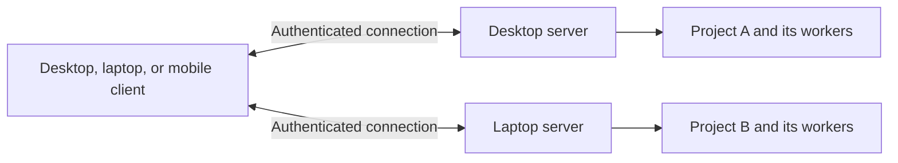

# 01 – Mitos product

Mitos is an operating system for agents: a server that keeps work moving across
people, agents, programs, and time, with clients for directing and inspecting it.
It makes a responsibility durable even when the agent carrying it out changes.
This is the product direction. The current build is a local Go server with a
browser workspace and CLI; the complete operating-system promise is not yet shipped.

## 1. Why Mitos exists

Agents can now perform substantial work, but the person using them often remains
the operating system. They start terminals, repeat context, decide who owns which
files, watch for stalled agents, carry answers between sessions, and determine
whether “done” means the result actually works. When a session ends or a machine
restarts, they reconstruct what happened and what remains safe to do.

That coordination burden grows with the number of agents and the duration of the
work. A faster model does not by itself preserve an assignment, stop two workers
from conflicting, remember an unanswered decision, or establish whether a remote
action succeeded before its response was lost.

Mitos exists to take responsibility for that continuity. A user should be able to
say “get this project to this outcome” or “keep this responsibility covered,” set
boundaries, and return to understandable progress, verifiable results, and the
specific decisions that still need their judgment.

## 2. Who it serves and where it starts

The initial customer is a developer or technical operator already using coding
agents, with several tasks or recurring responsibilities to manage. They want to
use existing agents and tools on their own projects and machines, without becoming
a full-time coordinator. Small engineering teams are the next audience once
shared identity and permissions are enforced.

The entry market is the operation of agent-assisted engineering work: coordinated
implementation, review, maintenance, dependency updates, and investigation. Coding
is a useful first application because repositories, tests, diffs, and build results
provide concrete work products and acceptance checks.

The larger opportunity is ongoing technical work across repositories and external
systems. An agent may investigate an advisory, a script may check affected versions,
a verifier may run tests, and a person may authorize publication. Mitos should
manage that whole responsibility even though its steps use different executors.
Research and other operational workflows can follow once this lifecycle works.

This scope is a product choice, not a measured market-size claim. We have not yet
established customer demand, willingness to pay, or a commercial pricing model.

## 3. Our view of the market

The market is converging from several directions. Coding workspaces make it easier
to use many agents. Agent frameworks make it easier to author and deploy agents.
Workflow systems make long-running programs recoverable. All are adding schedules,
human decisions, memory, and remote execution. Durable tasks and multi-agent
orchestration are already available elsewhere; they are not sufficient differentiation.

The following is a source-based snapshot checked on 2026-11-11. Availability is
based on official documentation, not an independent production-readiness audit.
Comparisons and product implications are our assessment.

| Product | Position and documented status | Implication for Mitos |
|---|---|---|
| **Orca** | Available coding workspace with desktop/mobile/remote operation. Its orchestration documentation marks the structured Run/Task/Dispatch layer experimental; remote servers and mobile are documented as beta. | Closest workspace competitor. Its durable coordination, replacement identities, and client/runtime separation are precedents to learn from. Mitos currently has less workspace breadth. [Orca](https://github.com/stablyai/orca), [orchestration](https://www.onorca.dev/docs/cli/orchestration), [remote](https://www.onorca.dev/docs/remote-servers), [mobile](https://www.onorca.dev/docs/mobile). |
| **OpenHands Agent Canvas** | Public, installable control center for multiple coding agents and automations, with local, Docker, remote, and cloud backends; documents scheduled and webhook workflows. | Direct competition for an always-on engineering workspace. Supporting several agents or self-hosted servers is already expected. [Official repository](https://github.com/OpenHands/OpenHands). |
| **Vercel Eve** | Public filesystem-first framework and installable CLI for durable agents; documents tools, skills, channels, schedules, and deployment. | Competes for developers assembling their own agents. Mitos should make existing executors operational without requiring every workload to be rewritten into its own agent framework. [Official repository](https://github.com/vercel/eve). |
| **LangGraph** | Available agent orchestration framework with persistent threads, checkpoints, memory, interrupts, and fault-tolerance mechanisms. | Agent authors already have persistence and human-involvement building blocks. Mitos must provide a coherent operating experience and enforced execution contracts around heterogeneous workers. [Persistence documentation](https://docs.langchain.com/oss/python/langgraph/persistence). |
| **Temporal** | Available durable-execution platform for applications, with persisted workflow progress and recovery across failures. | Adjacent infrastructure and a possible integration boundary. General workflow durability is established technology; Mitos's value must include agent operation, authority, workspaces, and verified outcomes. [Platform documentation](https://docs.temporal.io/temporal). |

The opportunity we are pursuing is a consistent operational contract across an
agent's entire responsibility: assignment, permissions, resources, collaboration,
replacement, verification, and recovery of uncertain external actions. We must
prove that contract in use. We should not claim that competitors universally lack
it, or that an “agent OS” label establishes a technical advantage.

## 4. What Mitos provides

A project is the lasting home for work. The user gives it a goal, context, working
rules, and access to resources. Concrete assignments become tasks that remain
visible through failed attempts and changes of agent. The user can always see
what is underway, what is waiting, what changed, and what has been accepted.

A supervisor coordinates work toward the goal. It can divide an assignment,
bring in workers, ask questions, and adapt to results. It is itself replaceable.
Mitos retains the plan, outstanding work, decisions, and limits outside the
supervisor's private conversation. A replacement starts from those facts.

Workers can be different agent harnesses or ordinary programs. They work within
the authority and resources granted to their assignment. A terminal or conversation
lets the user interact with a worker, while the task survives that particular
interaction. Changing the worker must not erase prior work or reset its allowance.

A service represents a responsibility that continues between tasks: review new
changes, watch for relevant advisories, or keep a dependency set maintained. It
creates or maintains work when a schedule, event, result, or human request calls
for it. The responsibility still exists while no agent is running.

Results come with inspectable changes and verification. A worker saying it has
finished is useful information; acceptance requires the checks declared for the
assignment. When the work exceeds its authority or needs judgment, Mitos presents
a concrete decision with context and consequences, and keeps it pending until
resolved under policy.

The resulting product promise is **continuity with accountable delegation**:
users can leave work with Mitos, change how it is executed, and return without
reconstructing the project from terminal histories. Reliable completion and reduced
coordination effort matter more than the number of agents running at once.

## 5. The server runs the work; clients connect to it

A **Mitos server** owns projects, task state, schedules, decisions, and managed
execution. It runs on a computer the user chooses. A **client** is a browser, CLI,
or other supported interface that connects to that server to inspect or direct
work. The server and a client may run on the same computer or different computers.
Each project has one **home server**. A server can manage several projects, and a
client can connect to several servers. There is no requirement for one central
server to own all of a user's work.

Four examples define the intended experience:

- **Everything on a desktop:** the desktop runs the Mitos server and its browser
  opens the local workspace. Closing that browser leaves the server working.
  Sleeping or shutting down the desktop affects the server and its workers.
- **Desktop server, phone client:** the same desktop keeps running Mitos. The
  phone connects to it to inspect work or answer a decision within its permissions.
  Closing the phone client changes nothing about execution. The desktop must
  remain awake and reachable; the phone does not take over its agents.
- **Always-on server, laptop and phone clients:** a home server or remote machine
  runs Mitos. The laptop and phone connect to that machine. The laptop can sleep
  while work continues because the execution host remains running.
- **Projects on different machines:** Project A belongs to the desktop server;
  Project B belongs to the laptop server. The same client connects to both and
  presents their projects, work, and decisions together, with the home server
  visible. Each server runs independently. If the laptop sleeps, Project B becomes
  unavailable and its local execution pauses or stops; Project A continues on the
  desktop. Cached information for B is marked stale until its server reconnects.

Remote access requires authenticated pairing and a network route. It does not
imply an automatically supplied cloud computer. A server may later place workers
on other execution hosts; that is a separate capability from connecting a phone
to a desktop server. Connecting to both servers does not make them share a scheduler
or transfer projects between them. Moving a project's home server requires an
explicit migration; an unavailable server is not automatically replaced by another.

Stopping a **client**, stopping the **Mitos server**, and losing the **host machine**
are different events. Client disconnect must not cancel work. Server restart must
recover durable state and reconcile execution; continued process execution depends
on the process-host capability. Power loss ends local processes, although saved
work can support later recovery. Durability does not mean uninterrupted execution
through every failure.

Today, the browser and CLI connect to a local server. The optional HTTPS device
API offers restricted snapshots and decision responses. Full paired remote clients,
native mobile applications, and remote worker placement are not implied by that
existing device interface. The combined view across several paired servers is a
required product capability, not a claim about the current local browser build.

## 6. Everyday use

For a substantial change, the user opens a project, reviews its context, and sets
a goal and boundaries. A supervisor delegates implementation and checking. The
user can inspect a worker's actual session, amend the goal, or resolve a question
without losing the relationship between task, worker, and result.

For maintenance, the user establishes a service such as assessing new security
advisories. It starts a new assessment when relevant input arrives, uses programs
for deterministic checks and agents for investigation, and asks for authority
before publishing or changing external systems when required.

When a worker fails or runs out of allowance, Mitos preserves its changes and
outstanding work. An authorized replacement continues from the assignment and
recorded facts. If a deployment may already have happened, Mitos shows that
uncertainty and reconciles it before proposing another attempt.

When returning from another device, the user connects to the same server and sees
the same work and decisions. They do not start a second agent to recover context.

## 7. Product commitments and boundaries

The product MUST preserve assignments across attempts, expose actual work and its
limits, distinguish reported success from accepted results, and retain decisions
across client disconnection. It MUST make the server and execution location clear.
Delegation MUST remain within authority and budget. Recovery MUST not silently
repeat an action whose outcome is unknown.

The first complete release should prove one engineering workflow through delegation,
waiting, worker replacement, server restart, independent verification, and human
resolution. Success means recoverable work, no duplicate external actions, clear
resource ownership, and less manual coordination. Measurements should include
accepted outcomes, failed recovery, correction effort, intervention time, and
resource use; fewer questions alone is not success.

Mitos currently has useful local batch and interactive foundations, but they do
not yet share all these guarantees. [Delivery and conformance](../system/06_DELIVERY_AND_CONFORMANCE.md)
separates the existing baseline from the remaining work. Mitos must earn the full
product promise through that implementation and validation.

The initial commitment is an engineering-work runtime operated on machines the
user chooses. Hosted multi-tenant operation, a commercial marketplace, and automatic
failover require separate product decisions after the core workflow is proven.
