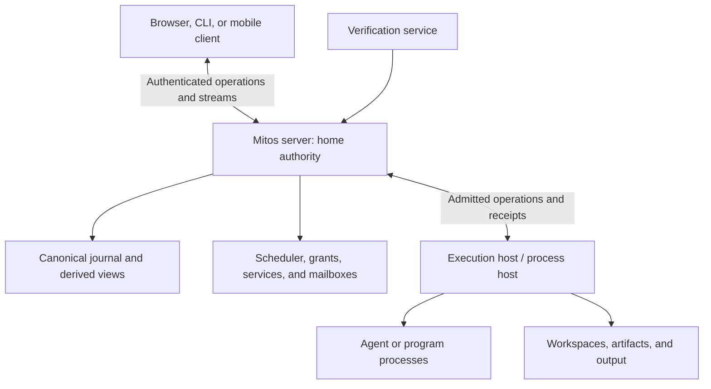

# 01 – Architecture

Mitos is a runtime above the host operating system for agents and deterministic
programs. It preserves responsibilities while their executors change. This document
owns the system model; the other system specifications define its contracts.
[Delivery and conformance](15_DELIVERY_AND_CONFORMANCE.md) distinguishes current
implementation from required behavior. See [ADR 0001](../ADRs/0001_DURABLE_AGENT_OS.md)
for the Orca comparison and architectural decision.

## Primitives

| Primitive | Meaning | Runtime responsibility |
|---|---|---|
| Task | Work with inputs, constraints, and a completion condition | Preserve assignment and accepted progress across attempts. |
| Process | Managed agent or program execution | Track identity, incarnation, lifecycle, parentage, and consumption. |
| Resource | Workspace, artifact, tool, model endpoint, or external service | Govern ownership, access, and limits. |
| Grant | Authority to perform specified operations | Enforce scope, delegation, expiry, and revocation. |
| Channel | Communication among workers, services, people, and sources | Deliver control messages with explicit receipt and acknowledgment. |
| Record | Persisted fact about work, decisions, effects, or results | Recover authoritative state and establish provenance. |

These identities MUST remain distinct. A Project groups goals, tasks, resources,
and policy. A Goal describes the desired outcome. A Service preserves activation
and lifecycle policy between tasks. A supervisory responsibility binds a task or
service to an inbox and a replaceable coordinator.

An Attempt is one execution of a task; existing Mitos **Run** IDs retain this
meaning. A Session binds interaction and history to execution. Orca's Run is a
coordination namespace; borrowing its mechanisms MUST NOT change Mitos's Run
semantics or existing identifiers.

## Roles and layers

Role, executor, and activation are independent. A supervisor, worker, or verifier
may use an LLM harness or deterministic program. A human request, schedule, event,
or task outcome may activate either. Admission and resource arbitration MUST be
deterministic even when an agent proposes the work.

| Layer | Owns |
|---|---|
| Runtime kernel | Identity, admission, lifecycle, scheduling, grants, resource claims, records, and control channels |
| System services | Supervision, verification, knowledge, activation, and notifications |
| Applications and clients | Engineering workflows, operational tools, browser workspace, CLI, and additional clients |

Applications MUST use the same admission and authority contracts as built-in
services. Neither a model prompt nor a UI restriction is an enforcement boundary.
The host/provider MUST implement any confinement or revocation being claimed.

## Deployment

The server owns task state and admission. The execution host owns actual processes
and provider enforcement. These roles MAY share a computer. A client is a view
and control interface, never an alternate authority. [Server and clients](02_SERVER_AND_CLIENTS.md)
defines deployment and failure boundaries.

## System invariants

The runtime MUST preserve authority, budgets, claims, decisions, and uncertain
external effects through retries and replacement. Worker-reported success MUST
remain distinct from accepted completion. Recovery MUST reconstruct known facts
without rerunning model reasoning or blindly repeating external actions.

A durable agent is a recoverable responsibility executed by replaceable processes.
It does not require an immortal process or preservation of model internals.
Native conversation history can supplement, but MUST NOT override, runtime state.

Mitos retains Go and its canonical journal. Storage replacement, multi-writer
replication, automatic host failover, commerce, and native mobile packaging are
not prerequisites for the core runtime. Adding them requires a separate decision
and conformance evidence, not reinterpretation of this architecture.
