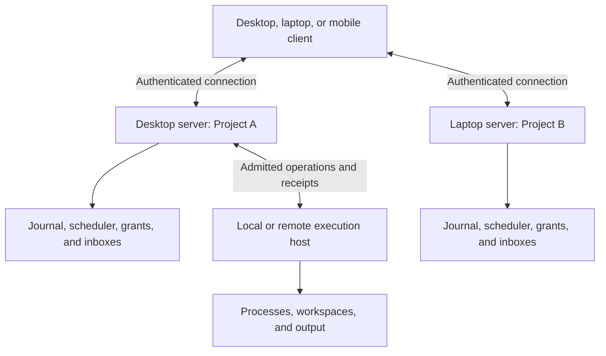

# 01 – Architecture and deployment

Mitos is a runtime above the host operating system for agents and deterministic
programs. It preserves responsibilities while executors change. This document owns
the system model and deployment boundaries. [Delivery](06_DELIVERY_AND_CONFORMANCE.md)
distinguishes current implementation from required behavior;
[ADR 0001](../ADRs/0001_DURABLE_AGENT_OS.md) records the lessons adopted from Orca.

## System model

| Primitive | Meaning | Runtime responsibility |
|---|---|---|
| Task | Work with inputs, constraints, and a completion condition | Preserve assignment and accepted progress across attempts. |
| Process | Managed agent or program execution | Track incarnation, lifecycle, parentage, and consumption. |
| Resource | Workspace, artifact, tool, model endpoint, or external service | Govern ownership, access, and limits. |
| Grant | Authority for specified operations | Enforce scope, delegation, expiry, and revocation. |
| Channel | Communication among workers, services, people, and sources | Deliver control messages with explicit acknowledgment and application. |
| Record | Persisted fact about work, decisions, effects, or results | Recover authoritative state and establish provenance. |

A Project groups goals, tasks, resources, and policy. A Goal describes the desired
outcome. A Service preserves activation and lifecycle policy between tasks. A
supervisory responsibility binds a task or service to an inbox and a replaceable
coordinator. These compositions MUST retain distinct identities.

An Attempt is one execution of a task; existing Mitos **Run** IDs retain this
meaning. A Session binds interaction and history to execution. Orca's Run is a
coordination namespace; adopting its mechanisms MUST NOT change Mitos identifiers.

Role, executor, and activation are independent. Supervisors, workers, and verifiers
may use LLM harnesses or ordinary programs. Requests, schedules, events, and task
outcomes may activate either. Admission and resource arbitration MUST remain
deterministic even when an agent proposes work.

| Layer | Owns |
|---|---|
| Runtime kernel | Identity, admission, lifecycle, scheduling, grants, claims, records, and control channels |
| System services | Supervision, verification, knowledge, activation, and notifications |
| Applications and clients | Engineering workflows, operational tools, browser workspace, CLI, and additional clients |

Applications MUST use the same runtime contracts as built-in services. Prompts and
UI restrictions are not enforcement boundaries. The host/provider MUST enforce any
confinement or revocation being claimed.

## Servers, clients, and execution hosts

Every project MUST have one **home server** owning task state, services, decisions,
grants, reservations, and receipts. A server MAY own several projects. A client
MUST support connections to several independent servers; no global primary is
required. Client caches and combined views MUST NOT establish authoritative state.

An execution host runs workers and owns their workspaces, output, and enforceable
limits. Its process host launches and inspects processes; it may be an in-process
adapter, separate daemon, or remote provider. These roles MAY share a computer.

| Deployment | Ownership and availability |
|---|---|
| Desktop server and local browser | Closing the browser leaves the server working. |
| Desktop server and phone client | Desktop remains awake and reachable; the phone does not take over execution. |
| Always-on server with laptop/phone clients | Clients may sleep while the execution host continues. |
| Desktop owns A; laptop owns B | A and B operate independently; one client can present both. |
| Remote worker placement | Home server retains authority; the worker host enforces admitted execution. |

## Multiple servers

Clients MUST maintain connections by stable server identity, endpoint, display name,
authentication scope, capabilities, and connection state. A hostname or label alone
MUST NOT establish identity. Pairing and revocation are per server; access to one
MUST NOT grant access to another.

Combined project, work, and decision views MUST preserve home-server identity.
Commands MUST route to that server even when local names or IDs overlap. Each
server retains its own journal, admission, budgets, and receipts. Aggregating views
MUST NOT create a global scheduler or a second writer.

If B's laptop becomes unreachable, the client MUST mark its cached state stale,
distinguish unknown execution from confirmed stop, and keep A's connection usable.
Mutations MUST NOT silently fall back to another server. Reconnection MUST reconcile
revisions and pending receipts with the original authority before retrying work.

Connecting to multiple servers requires no server-to-server coordination. Remote
placement, cross-server delegation, and transferring a project's home are separate
capabilities. Home migration requires explicit transfer, one writer, and settlement
of live execution; it is outside the initial multi-server client gate.

## Failure boundaries

| Event | Required behavior |
|---|---|
| Client disconnect | Execution continues; reconnect restores the authoritative view. |
| Server restart | Replay durable state and reconcile pending execution before replacement. |
| Process host survives server restart | Reattach only using exact incarnation and launch receipt. |
| Host power loss | Record interruption or uncertainty; saved work supports recovery, not process survival. |
| Network partition | Preserve uncertainty and unsafe claims; lack of contact does not prove exit. |

Process survival, durable state, executor replacement, and host failover MUST be
advertised separately. A provider without surviving-process inspection MUST NOT
claim seamless restart. A PID alone MUST NOT establish process identity.

During a partition, previously admitted remote work MAY continue only within locally
enforceable grants and limits. Hosts MUST NOT invent new authority or release claims
for an unreachable home server. Reconnection MUST reconcile custody and results
before conflicting work starts. Automatic takeover and live migration are excluded.

## Architectural commitments

A durable agent is a recoverable responsibility executed by replaceable processes.
Native conversation history MAY supplement, but MUST NOT override, runtime facts.
The runtime MUST preserve authority, budgets, claims, decisions, and uncertain
external effects through replacement. Reported success is distinct from acceptance.

Mitos retains Go and its canonical journal. Storage replacement, replicated writers,
commercial settlement, and automatic failover require separate decisions. Details
of admission and recovery belong to [runtime](02_RUNTIME.md); connection security,
client protocols, and adapters belong to [interfaces](05_INTERFACES_AND_INTEGRATIONS.md).

Asynchronous messaging across process/server boundaries MUST use MQTT 5 with a
versioned Mitos payload schema. Brokers transport messages; each project's home
server retains authority and canonical state. This does not require one global
broker or merge independent servers. [ADR 0002](../ADRs/0002_MQTT5_MESSAGING.md)
records the protocol decision. The initial adapter uses Paho with an external
broker and signed, explicitly authorized peer messages.

The local migration uses the canonical Store writer for both batch events and
versioned workspace metadata. A legacy desk snapshot is imported once and retained
as backup; journal replay becomes authoritative. Common Task/Run projections expose
new interactive bindings without manufacturing bindings for old sessions. Execution
adapters remain distinct during this cutover. This staging does not relax the common
admission, accounting, or enforcement target; delivery gates remain authoritative.
