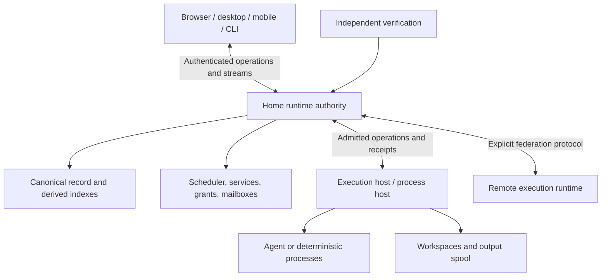

# Agent operating system architecture

Status: normative target architecture, accepted 2026-11-11.
Decision: [ADR 0004](../ADRs/0004_DURABLE_AGENT_OS.md).
Conformance: [implementation ledger](IMPLEMENTATION_STATUS.md).

Mitos MUST provide a common execution environment for agents and deterministic
programs. Services preserve ongoing responsibilities, Tasks preserve concrete
work, and replaceable Processes execute attempts. The runtime MUST govern
authority, resources, communication, and durable state independently of any
particular model, harness, conversation, or user interface.

This is a runtime above the host operating system. Host/provider mechanisms
enforce confinement; a model's agreement to a prompt is not an access control.
Local and remote deployment MUST use the same conceptual execution contract.
Multi-tenant hosting and commerce are optional applications of that contract,
not prerequisites for managing local work.

## 1. Primitives and compositions

| Primitive | Meaning | Required guarantee |
|---|---|---|
| Task | Work with inputs, constraints, and a completion condition | Identity and accepted progress survive executor replacement. |
| Process | Managed execution by an agent harness or deterministic program | Lifecycle, parentage, incarnation, cancellation and accounting. |
| Resource | Workspace, artifact, tool, model endpoint or external service | Addressable identity, ownership, access policy and limits. |
| Grant | Authority for specified operations | Enforced scope, bounded delegation, expiry and revocation. |
| Channel | Communication among processes, services, humans and sources | Explicit durable delivery and acknowledgment for control messages. |
| Record | Decisions, observations, effects, receipts and results | Recoverable authoritative state and traceable evidence. |

Project, Goal, Service, Attempt, Session, and supervisory responsibility compose
these primitives. Their identities MUST remain distinct:

- A Project groups goals, resources, services, and access policy.
- A Goal describes an outcome and constraints; Tasks organize its work.
- A Service owns activation and lifecycle policy even while no Process runs.
- An Attempt binds one execution to a Task. Existing Mitos Run IDs MUST retain
  this meaning. Orca's Run is a coordination namespace; adopting its mechanisms
  MUST NOT change existing Mitos identifiers or history.
- A Process executes an Attempt and may own multiple host processes. A PID alone
  MUST NOT establish identity or authority.
- A Session is an addressable interaction/history binding. Terminal and chat views
  MUST refer to that binding. Native resume that creates a new execution MUST
  record the new Attempt/Process relationship.
- A supervisory responsibility binds a coordination Task or Service to an inbox
  and current coordinator generation. The namespace itself MUST NOT schedule
  work or consume model capacity.

A packaged Capability supplies data, skills, and tools. Installing it MUST NOT
grant its requested authority. A deterministic application need not invoke a
model to receive scheduling, resource control, verification, and recovery.

## 2. Roles, executors, and activation

| Dimension | Examples |
|---|---|
| Role | Supervisor, worker, verifier |
| Executor | LLM harness, deterministic program |
| Activation | Human request, schedule, external event, task outcome |

These dimensions MUST be independent. A scheduled Task MAY invoke an LLM; an
event MAY invoke a deterministic program. A supervisor MAY reason with a model
or apply fixed policy. Runtime admission and resource arbitration MUST be
deterministic even when an agent proposes the plan.

## 3. Deployment and ownership

The home runtime MUST own authoritative Task state, admission, budget reservations,
and coordination. The execution host MUST own process identities, execution
receipts, output, and provider enforcement. These roles MAY share a machine.
Clients MUST operate on the same managed objects through authenticated operations.
Clients MAY cache views/drafts; they MUST NOT become an alternate authority for
completion, grants, or resource release.

Browser disconnect, desktop exit, and phone sleep MUST NOT implicitly cancel work.
A process host supporting control-plane restart MUST expose durable launch receipts
and exact reattachment identity. Without that capability, the runtime MUST report
interruption and require reconciliation. Process survival, durable work state,
executor replacement, and host failover MUST be advertised as separate capabilities.

Remote access MUST use authenticated, revocable, scoped client bindings. Relays
and push services MAY transport connections and notifications; they MUST NOT
acquire execution authority. Notifications MUST link to authoritative requests;
delivery/dismissal MUST NOT resolve decisions. SSH placement alone MUST NOT be
advertised as a complete remote runtime or an isolation guarantee.

## 4. Durable supervision

A durable agent is a logical responsibility with recoverable work, authority,
messages, and context, executed by replaceable processes. It does not require
preserving model internals or keeping a model call continuously active.

The runtime MUST persist coordinator binding and generation. Replacement MUST
advance that generation and reject stale control mutations and mailbox settlement.
Each proposal MUST name its observed state revision and current authority.
Workers MUST report against an exact Task, Attempt, and execution incarnation.
Late reports MAY remain evidence but MUST NOT complete a replacement attempt.

The coordinator MAY propose subtasks, placement, integration, recovery, and plan
amendments. The runtime MUST enforce grants, claims, budgets, and dependency
revisions before execution. Delegation MUST NOT expand authority or reset spending.
Independent admitted work MAY continue while its coordinator is unavailable;
work requiring a new decision MUST wait visibly.

Replacement context MUST include the durable assignment, task graph, pending
messages/decisions, accepted artifacts and verification, remaining budget, active
claims, and unresolved external operations. Native conversation history MAY
supplement this context; it MUST NOT override authoritative facts.

## 5. Services, waiting, and communication

Services MUST declare activation, Task template, execution specification, and
operating policy. Policy MUST define duplicate delivery, missed occurrences,
overlap, backpressure, retries, and shutdown behavior.

Control channels MUST support stable message identity, causal references,
bounded delivery, acknowledgment, consumer generations, and cancellation.
Adapter delivery MUST NOT count as application of an action. Topic posts MUST NOT
acquire claims, grant authority, or constitute verified completion.

Waiting MUST preserve work and wake conditions. Scheduler capacity MAY be released
only when execution state and retained resources justify it. A waiting model with
a running shell or VM still consumes resources. Wait registration MUST avoid
losing a result that arrives between checking and subscribing.

## 6. Verification, effects, and knowledge

The runtime MUST distinguish process exit, worker-reported success, and accepted
Task completion. Acceptance MUST bind evidence to the declared completion
condition and exact result revision. Only the authorized acceptance path MAY
establish acceptance. Supervisors MUST NOT rewrite criteria to obtain a pass.

Records MUST reconstruct known state without replaying model reasoning. Recovery
MUST inspect pending receipts and reconcile possible external effects. An absent
success record MUST NOT prove that nothing happened. Unknown outcomes MUST remain
explicit until resolved; restoring files does not undo a deployment or payment.

Authoritative state, saved artifacts, and learned knowledge MUST be separate.
Knowledge MUST carry provenance, scope, revision, and supersession. Proposed
lessons MUST NOT mutate authoritative metrics or become grants. Context assembly
MUST disclose unresolved or contradictory evidence.

## 7. Layers and implementation boundary

| Layer | Owns |
|---|---|
| Kernel | Identity, admission, lifecycle, scheduling, ownership, grants, records and control channels |
| System services | Supervision, verification, knowledge, brokering, activation and notifications |
| Applications and clients | Coding teams, operational workflows, Studio, CLI, handhelds and optional commerce |

The [durable runtime contract](DURABLE_RUNTIME.md) specifies admission and failure
behavior. The [implementation plan](09_IMPLEMENTATION_PLAN.md) defines conformance
gates. Current batch execution and interactive sessions use different stores and
lifecycles; this architecture requires unification and does not claim it has
occurred. Migration MUST preserve current endpoints and evidence unless an explicit
versioned change is accepted.
